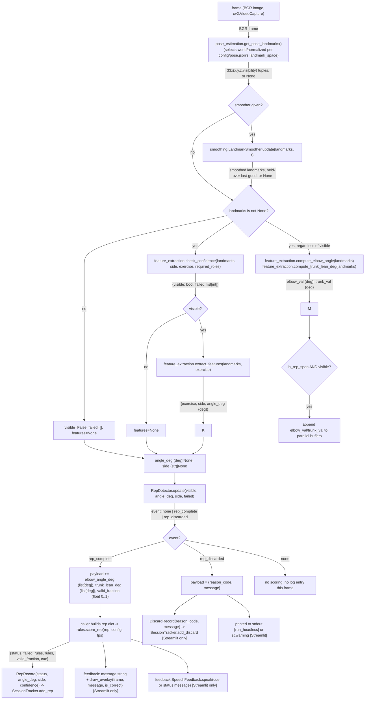

# Data flow

Both diagrams are drawn from `src/pipeline.py`'s actual call order
(`process_frame`, `Session`, plus the per-caller code in `app.py`'s
`run_headless` / Streamlit body), not from an assumed pipeline shape. One
deviation from the commonly-assumed order is called out explicitly below
— see the note under the flowchart.

## Session gating, after pose estimation, before everything else

Every caller still calls `pose_estimation.get_pose_landmarks(frame)`
unconditionally, every frame, regardless of session state (this did
NOT change) — it's what happens to that result that's gated. The
landmarks are then handed to `src.pipeline.Session.process_frame()`
instead of the bare module-level `process_frame()` directly. While
`session_state` is `IDLE` (before Start) or `STOPPED` (after Stop),
`Session.process_frame()` returns `("idle", None, False, [])`
immediately — the landmarks are discarded right there: never smoothed,
never confidence-gated, never reaching `RepDetector`, never counted,
buffered, or logged. Only while `CALIBRATING`/`ACTIVE` does
`Session.process_frame()` forward to the module-level `process_frame()`
shown in the flowchart below, unchanged. See `docs/module_interfaces.md`'s
`src/pipeline.py` section for the 4 states.

## Live loop, per frame



**Note on order**: smoothing runs **before** the confidence gate in the
real code (`process_frame`: `if smoother is not None: landmarks =
smoother.update(landmarks, t)` happens first, then `check_confidence` is
called on the possibly-smoothed landmarks). `compute_elbow_angle`/
`compute_trunk_lean_deg` are also computed unconditionally whenever
landmarks exist, **regardless of whether the confidence gate passed** —
only their use (being appended into the per-rep buffers that
`rules.score_rep` eventually sees) is gated by `visible`. If a design
document elsewhere describes "confidence gate → smoothing," that is not
what the code does — flagged in `docs/open_questions.md`.

## One repetition's lifecycle (sequence diagram)

Two branches shown: a repetition that passes the confidence gate on
enough frames (ordinary pass/fail path) and one that doesn't (the
`insufficient_data` path). Both go through the same functions — only the
`valid_fraction` computed along the way differs.

```mermaid
sequenceDiagram
    participant Cam as Video/webcam frame source
    participant Sess as pipeline.Session
    participant Pose as pose_estimation
    participant Smooth as smoothing.LandmarkSmoother
    participant Feat as feature_extraction
    participant Det as RepDetector
    participant Rules as rules.score_rep
    participant Track as SessionTracker
    participant FB as feedback

    Note over Sess: IDLE until Start() is called (or --span's START frame)\nSTOPPED after Stop() (or --span's END frame) -- landmarks\nare discarded in either state, before Smooth/Feat/Det run

    loop one frame at a time, RESTING -> MOVING -> RESTING
        Cam->>Pose: frame (unconditionally, every frame -- unchanged)
        Pose->>Sess: landmarks or None
        Sess->>Sess: session_state == IDLE/STOPPED? discard here and skip to next frame
        Sess->>Smooth: landmarks (only while CALIBRATING/ACTIVE)
        Smooth->>Feat: landmarks (smoothed / held-over / None)
        Feat->>Feat: check_confidence(required_roles)
        alt confidence gate passes
            Feat->>Det: visible=True, angle_deg (deg), side
            Note over Feat: elbow_val, trunk_val appended to parallel buffers
        else confidence gate fails
            Feat->>Det: visible=False, angle_deg=None, side=None
            Note over Feat: elbow_val/trunk_val computed but NOT appended
        end
        Det->>Det: update rep_buffer / bad_confidence_streak
    end

    Det->>Rules: rep_complete: {angle_deg[], elbow_angle_deg[], trunk_lean_deg[], valid_fraction}

    alt valid_fraction >= config.min_valid_fraction
        Rules->>Rules: evaluate peak_angle, elbow_straight, trunk_lean, tempo
        alt all 4 rules pass
            Rules-->>Track: status="pass"
            Rules-->>FB: "Good form!" (speak + green overlay)
        else at least one rule fails
            Rules-->>Track: status="fail", failed_rules=[...]
            Rules-->>FB: "Needs adjustment: ..." + per-rule cue (cooldown-gated)
        end
    else valid_fraction < config.min_valid_fraction
        Note over Rules: rules are still evaluated (for calibration-set\nreporting) but the verdict is overridden
        Rules-->>Track: status="insufficient_data"
        Rules-->>FB: config.cues.insufficient_data ("Keep your whole arm in view.")
    end

    Track->>Track: RepRecord written; SessionTracker.save() on session stop\n-> {user}_{exercise}_{stamp}.csv + .summary.json
```
